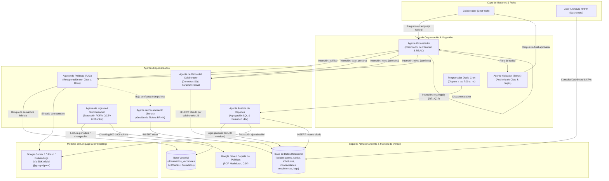
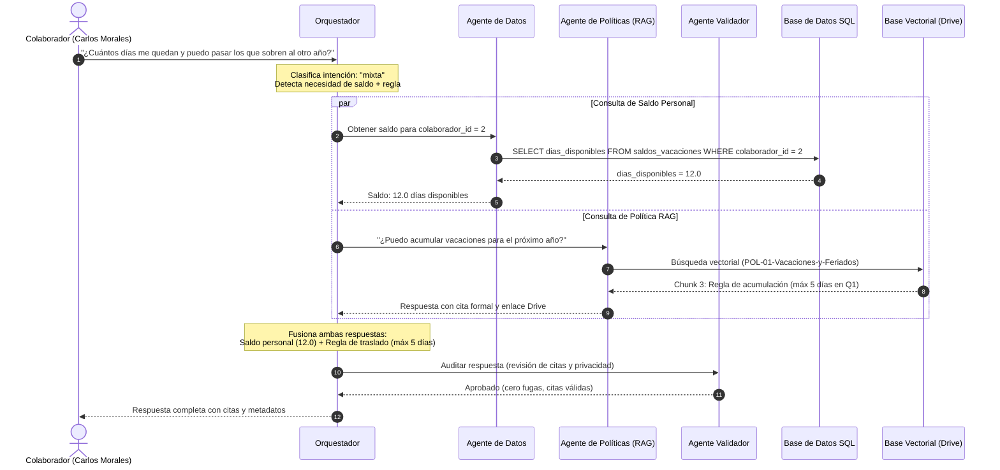
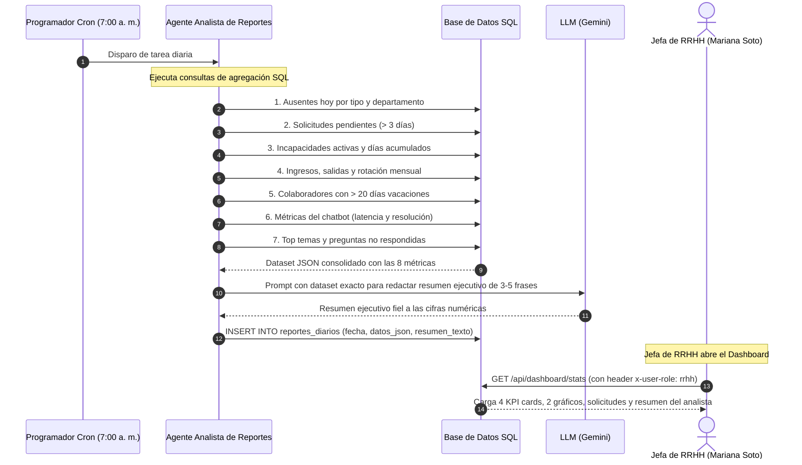

# DIAGRAMA Y ESPECIFICACIÓN DE ARQUITECTURA DEL SISTEMA
## Portal de Consulta de Políticas de Recursos Humanos con RAG Multiagente
**Organización:** Innovatech Solutions S.A.  
**Plataforma Tecnológica:** Node.js (Express), Better-SQLite3, Hybrid Vector RAG, Google Gemini SDK y React SPA  
**Versión:** 2.1 (Producción)  
**Fecha:** 18 de Noviembre de 2026  

---

## 1. Visión General de la Arquitectura

El sistema implementa una arquitectura desacoplada de dos caminos independientes:
1. **Camino Conversacional (On-Demand):** Activado por consultas de colaboradores en lenguaje natural, administrado por un **Orquestador** que clasifica la intención, aplica filtros de privacidad de datos personales y delega a agentes especializados (**Agente de Políticas RAG** o **Agente de Datos del Colaborador**), auditado por un **Agente Validador**.
2. **Camino de Reportería Diaria (Batch / Scheduled):** Activado automáticamente cada mañana a las **7:00 a. m.** mediante un scheduler (`node-cron`), donde el **Agente Analista de Reportes** ejecuta agregaciones SQL, sintetiza un resumen ejecutivo estrictamente apegado a las cifras y persiste el informe en la tabla `reportes_diarios`, el cual es consumido de forma exclusiva por usuarios con rol RRHH en el Dashboard.

---

## 2. Diagrama de Componentes y Flujo de Datos

---

## 3. Diagrama de Secuencia: Consulta Mixta (Pregunta 19)

El siguiente diagrama detalla cómo el orquestador coordina múltiples agentes para responder preguntas compuestas como:  
*"¿Cuántos días me quedan y puedo pasar los que sobren al otro año?"*

---

## 4. Diagrama de Secuencia: Reportería Diaria Programada (7:00 a. m.)

---

## 5. Matriz de Responsabilidades de los Agentes

| Agente | Responsabilidad Principal | Herramientas Utilizadas | Salida Entregada |
|---|---|---|---|
| **Orquestador** | Clasificación de intención, gestión de memoria de sesión, enrutamiento, rechazo de consultas prohibidas (Q21/Q22) y fusión de respuestas mixtas. | Clasificador LLM / Reglas semánticas, RBAC. | Agente destino, consulta reformulada o negativa formal. |
| **Políticas (RAG)** | Respuestas exclusivas sobre normativas internas a partir de documentos de Google Drive. | Búsqueda vectorial híbrida (TF-IDF/BM25/Gemini), LLM. | Respuesta estructurada + citas oficiales (documento, sección, enlace). |
| **Datos del Colaborador** | Consulta de saldos personales, estado de solicitudes, fechas de pago y evaluaciones. | SQL parametrizado `WHERE colaborador_id = ?`. | Respuesta con cifras numéricas exactas. |
| **Analista de Reportes** | Generación de la foto diaria del personal a las 7:00 a. m. y bajo demanda. | Agregaciones SQL, LLM para síntesis ejecutiva sin números inventados. | Registro JSON en `reportes_diarios` + resumen de 3-5 frases. |
| **Ingesta & Sincronización** | Mantenimiento del índice vectorial al día con cambios en Drive (PDF, MD, CSV). | Drive connector, chunker de 500-1000 tokens, generador de embeddings. | Chunks actualizados en `documentos_vectoriales`. |
| **Validador (Bonus)** | Auditoría de seguridad y fidelidad de citas antes del despacho al usuario. | Reglas de privacidad Ley N° 8968, parser de citas. | Veredicto booleano y respuesta aprobada o bloqueada. |
| **Escalamiento (Bonus)** | Generación de tickets formales para RRHH cuando la política no existe en los documentos. | Inserción en `tickets_escalamiento`. | Número de radicado `#TICK-X` y tiempo estimado de respuesta. |
